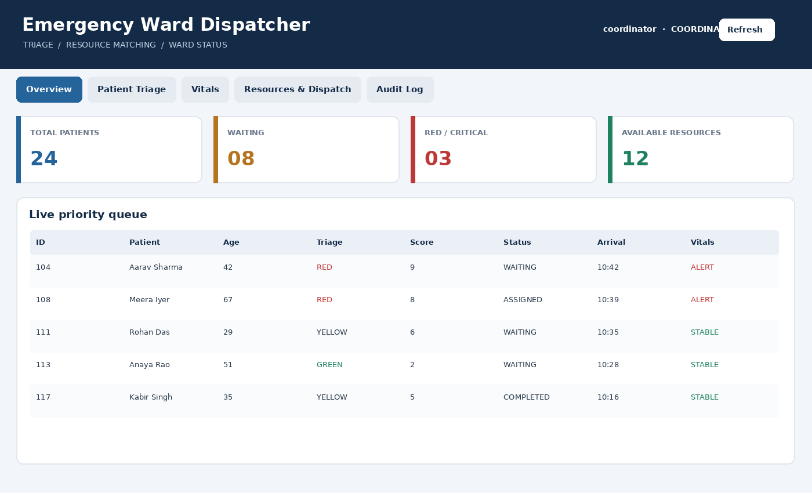
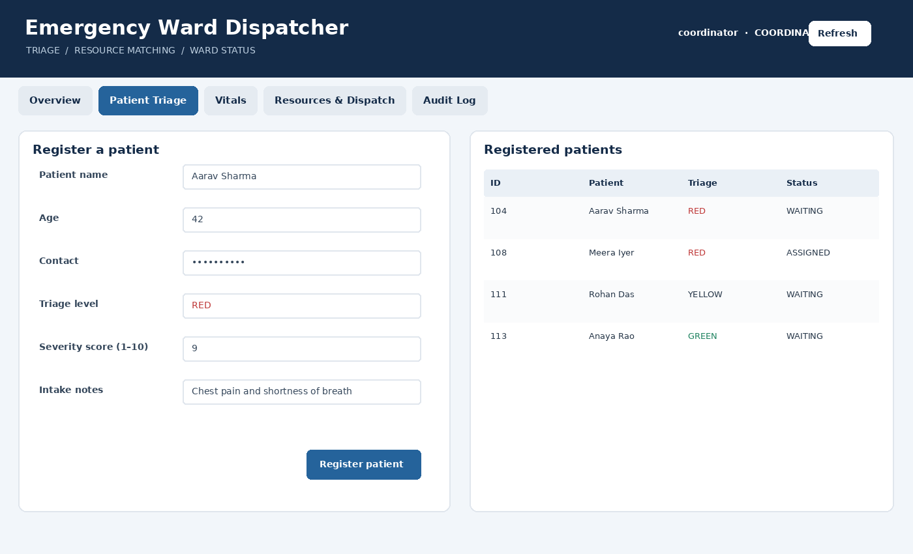
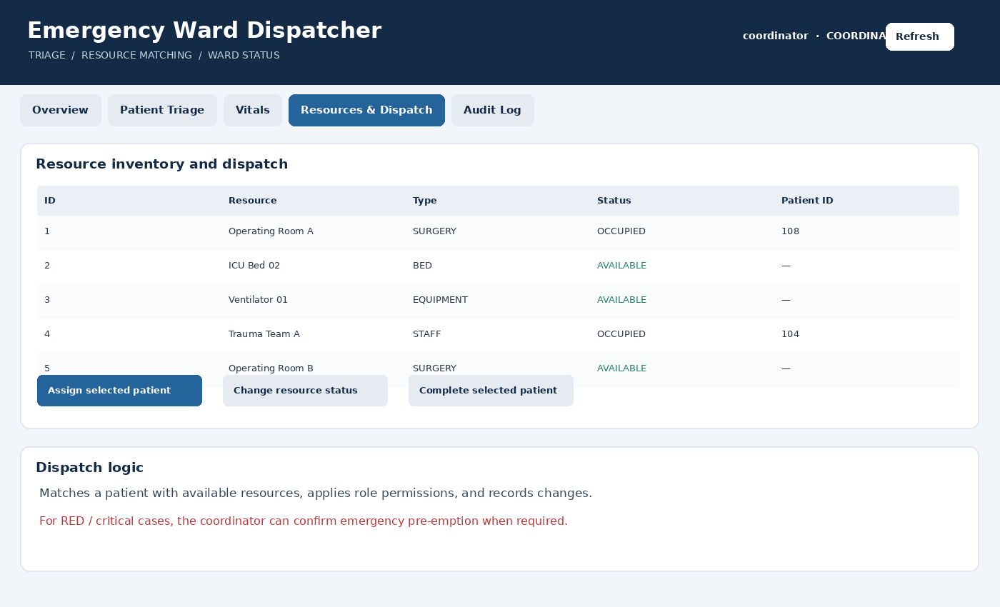

<div align="center">

# 🚑 Emergency Ward Dispatcher

### Java • Swing • SQLite • Object-Oriented Programming

A desktop prototype for coordinating emergency patient triage, vital-sign monitoring, and clinical resource allocation in one place.

  

</div>

---

## 🏥 What it does

Emergency Ward Dispatcher is a small hospital-operations demo designed to show how patient urgency and resource availability can be managed through a single desktop interface. Instead of keeping patient intake, observations, and resource assignments separate, the application brings these workflows together and stores records in a local SQLite database.

> **Educational prototype only:** this project is not a medical device or a production hospital information system. Its triage rules are simplified examples; real clinical decisions must be made by qualified professionals.

## ✨ Main features

- **Ward overview:** summary cards and a priority queue give staff a quick view of registered patients, waiting cases, critical cases, and available resources.
- **Patient registration and triage:** record basic patient details, intake notes, triage level, and a severity score.
- **Vitals tracking:** save blood pressure, pulse, oxygen saturation, temperature, and respiratory rate, with alerts when configured thresholds are crossed.
- **Resource inventory:** view clinical resources and their status, including availability and current assignments.
- **Resource dispatch:** assign available resources to a selected patient and update assignment status.
- **Emergency pre-emption demonstration:** for a RED / critical case, an authorised user can confirm pausing an active assignment when resources are not otherwise available.
- **Role-aware permissions:** coordinator and administrator roles can manage dispatch actions; other roles have more limited access.
- **Audit history:** resource and workflow changes are recorded so actions can be reviewed.
- **Persistent records:** patient, resource, and audit data are stored in SQLite rather than existing only while the window is open.

## 🖥️ Interface previews

The following are **custom-made illustrative previews** of the application's interface, created for this README. Sample names and counts are fictional and are not live records from the database.

### 1. Ward overview

The overview brings the key ward indicators and patient priority queue together.



### 2. Patient registration and triage

Staff can capture intake details and assign a triage category and severity score.



### 3. Resource inventory and dispatch

The dispatch screen brings resource status and patient assignment actions into one workflow.



## 🧠 Object-oriented design

The project is structured to demonstrate core OOP principles through a practical scenario.

| Concept | Where it appears | Why it matters |
|---|---|---|
| **Encapsulation** | `Patient`, `Vitals`, `Resource`, and `User` | Keeps object data together and exposes it through methods. |
| **Abstraction** | Abstract `User` and `Resource` classes | Defines common behaviour without tying every operation to one specific type. |
| **Inheritance** | `StaffUser extends User`; `ClinicalResource extends Resource` | Reuses shared fields and behaviour in specialised classes. |
| **Polymorphism** | Role-specific `canManageResources()` behaviour | Allows the application to work with a common user type while behaviour varies by role. |
| **Enums** | `SeverityLevel` and `UserRole` | Represents fixed categories consistently. |
| **Separation of concerns** | `model`, `service`, `data`, and `ui` packages | Separates domain objects, application rules, database access, and interface code. |

## 🗂️ Project structure

```text
EmergencyDispatcher_Full/
├── src/hospital/
│   ├── Main.java                 # Application entry point
│   ├── model/                    # Patient, user, resource, and vitals classes
│   ├── service/                  # Hospital workflow and dispatch rules
│   ├── data/                     # SQLite database operations
│   └── ui/                       # Swing windows and forms
├── screenshots/                  # README interface previews
├── lib/                          # SQLite JDBC driver
├── hospital.db                   # Local SQLite database
└── README.md
```

## 🧰 Technology

- **Java Swing** — desktop user interface
- **SQLite** — local relational database for persistent records
- **JDBC** — connection between Java and SQLite
- **JDK 17+** — Java development environment

## 🔐 Safety and data note

This is a classroom demonstration. Use fictional patient data only. The included database and demo credentials, if present in the project files, are for local demonstration and must not be used for real patient information or exposed as production credentials.

---

<div align="center">

**Built as an Object-Oriented Programming project**

*Organising emergency workflows through clear classes, service logic, and persistent storage.*

</div>
